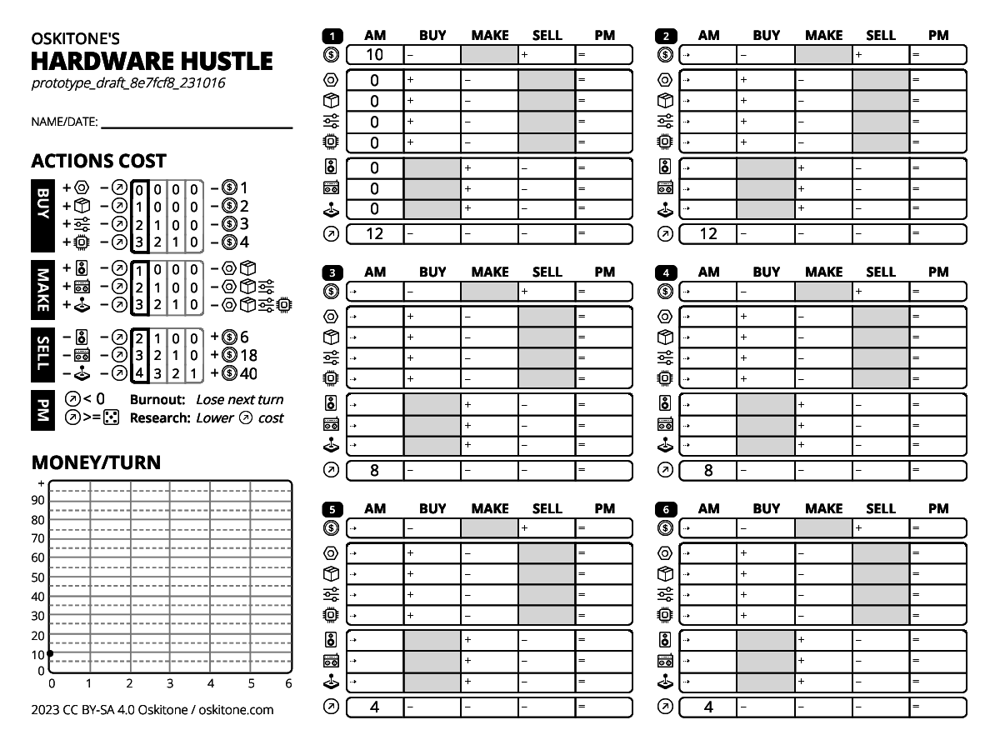

import classnames from "classnames";

import styles from "@/styles/Rules.module.css";

import { ID_TITLE } from "../components/sidebar";
import PhasesTable, { ACTIONS } from "../components/phases-table";
import Icon, {
  Money,
  Opportunity,
  A,
  B,
  C,
  D,
  AB,
  ABC,
  ABCD,
  Roll,
  MoneyX,
  OpportunityX,
  AX,
  BX,
  CX,
  DX,
  ABX,
  ABCX,
  ABCDX,
  RollX,
  IconsParen
} from "../components/icon";
import { ColumnBreak, NoBreak, NoWrap } from "../common/utils";
import Turn, { ExampleCell, firstTurnSuppliedColumns } from "../components/turn";
import { RollTableParents, RollTableChildren } from "../components/roll-table";
import Wordmark from "../components/wordmark";

<Wordmark className={styles.Wordmark} wrap={true} draftId={props.draftId} />

# {props.zine ? "Game Zine Edition" : "Rules"}

## Introduction

Hardware Hustle is a tabletop, <NoWrap>roll-and-write</NoWrap> resource management game about running an indie electronics business.

Buy, make, sell, and research your way to profit without burning out!

_For one or more players. {props.zine && "(Photocopy a blank game sheet spread for each player.)"} Ages 10+. ~20min to play._

## Game Overview

You have six turns to buy parts to make widgets, make widgets from parts, sell widgets for money to buy more parts, and so on.

Completing turn phase actions uses opportunity <IconsParen ids={["opportunity"]} />, which depletes as the game progresses and is limited per-phase by a die roll. At the end of each turn, attempt research using remaining <Opportunity /> to reduce future turns' <Opportunity /> costs.

The six turns are miniature spreadsheets, and the game is over when they're all filled out. The player with the most money at the end wins.

## Components

Each player will need:

- Hardware Hustle game sheet{props.zine && "/zine"} <NoWrap>{props.gameSheetsOnReverseSide && "(See reverse side of paper)"}</NoWrap>
- Six-sided die{props.rollTablePanelsCount > 0 && `, "Roll Table" (see Appendix for usage),`} or some way to get a random number from 1 to 6
- Pen or pencil
- Calculator or scratch paper for math (optional)

## Game Setup

Familiarize yourself with the game sheet's layout: Phases table, Money/Turn graph, and six turn spreadsheets.

<NoBreak>There is no player order, game sheets are filled out simultaneously, and die rolls can be done by any player.</NoBreak>

## How to Play

The spreadsheets' rows are grouped into money <IconsParen ids={["money"]} />, parts <IconsParen ids={["A", "B", "C", "D"]} />, widgets <IconsParen ids={["AB", "ABC", "ABCD"]} />, and opportunity <IconsParen ids={["opportunity"]} />.

And their five columns are phases that you fill out from left to right during your turn.

1. ### Go
   Take stock of what you have and need
1. ### Buy
   Buy parts <IconsParen ids={["A", "B", "C", "D"]} /> using <Money /> and <Opportunity />
1. ### Make
   Make widgets <IconsParen ids={["AB", "ABC", "ABCD"]} /> using parts and <Opportunity />
1. ### Sell
   Sell widgets for <Money /> using <Opportunity />
1. ### End
   Use remaining <Opportunity /> to research or lose next turn if <Opportunity /> is negative

(Refer to the *Appendix*'s *Example First Turn* for a glimpse of everything in action and an *Icon Glossary* that says what the icons are called.)

### 1. Go

You begin each turn by taking stock of what you have and what you might need.

For the game's first turn, there's nothing to do here besides note the starting pre-filled values. You have <MoneyX value={10}/> and <OpportunityX value={12}/>... and you need basically everything else.

(Later turns will have empty cells to fill out, but there still won't be any decision-making or die-rolling. For those reasons, Go is not listed in the Phases table on the left of your game sheet.)

### 2. Buy

Before you can make any money <IconsParen ids={["money"]} /> selling widgets, you've got to spend money to buy their parts.

Parts cost <Money /> and <Opportunity />, as listed in the Phases table:

<PhasesTable phases={[ACTIONS.BUY]} className={styles.PhasesTable} />

The <Opportunity /> costs are a table of values, but, for all the phases of your first turn, you'll only use the ones in the leftmost column with the dark outline.

For example, to buy a <A suffix={","} /> you need <OpportunityX value={0} /> and <MoneyX value={1} />; to buy a <B /> you need <OpportunityX value={1} /> and <MoneyX value={2} />; etc. You'll revisit <Opportunity /> costs in the End phase a little later.

To complete the Buy phase:

1. **Roll for "Buy":**
    * Roll a die and call out its value. This <Roll /> is the _maximum_ <Opportunity /> that each player can spend buying this turn.
    * Based on the max <Opportunity /> that was just rolled and how much <Money /> you have in the Go column, decide which parts to buy.
1. **Write:**
    * In the Buy column, write the values for the total <Money /> cost, the parts you bought, and the total <Opportunity /> they _used_ (not the rolled value).

Notes:

- The value of the <Opportunity /> roll is shared by all players, and everyone fills in their game sheets simultaneously.
- You can buy as many or as few parts as you want and even multiples of the same part, as long as you have the required <Opportunity /> and <Money suffix="." />
- You can spend less <Opportunity /> than you roll, but you can't spend more. You also can't spend more <Money /> than you have available.
- You can also choose to buy nothing and skip this phase, though that's a gutsy move on your first turn!
- Cells are prefixed by their mathematical operation. You're losing <Money /> and <Opportunity />, so those cells have a `-`. You're gaining parts, so they have a `+`. The same `-`/`+` signs are in the Phases table.
- Unused cells have a gray background to mark they're skipped.
- Cells with no change can be crossed out, filled with 0, or just left blank.
- Don't move on to the next phase until all players are ready.

### 3. Make

Now you'll use the parts you bought to make widgets to sell.

The Phases table lists the widgets you can make, their outlined <Opportunity /> costs, and the parts they'll use:

<PhasesTable phases={[ACTIONS.MAKE]} className={styles.PhasesTable} />

To complete the Make phase:

1. **Roll for "Make":**
    * Roll a die and call out its value. This <Roll /> is the _maximum_ <Opportunity /> that each player can spend making this turn.
    * Based on the max <Opportunity /> that was just rolled and which parts you have available, decide which widgets to make.
1. **Write:**
    * In the Make column, write the values for the parts you used, the widgets you made, and the total <Opportunity /> they used.

You can make as many or as few widgets as you want, provided you have the required parts and <Opportunity />. In later turns, you can use parts purchased in previous turns.

### 4. Sell

If you made any widgets, now's a fine time to sell them so you have <Money /> for your next turn's Buy phase.

Notice how the Phases table for Sell has you losing widgets but gaining <Money />:

<PhasesTable phases={[ACTIONS.SELL]} className={styles.PhasesTable} />

To complete the Sell phase:

1. **Roll for "Sell":**
    * Roll a die and call out its value. This <Roll /> is the _maximum_ <Opportunity /> that each player can spend selling this turn.
    * Based on the max <Opportunity /> that was just rolled and which widgets you have available, decide which widgets to sell.
1. **Write:**
    * In the Sell column, write the values for the <Money /> you made, the widgets you sold, and the total <Opportunity /> they used.

Sell as many or as few widgets as you want, provided you have the required widgets and <Opportunity />. In later turns, you can sell widgets made in previous turns.

### 5. End

It's time to wrap it up and end the turn.

To complete the End phase:

1. **Roll for "Research":**
    * Roll a die and call out its value. This <Roll /> is the _minimum_ <Opportunity /> for research.
1. **Write:**
    * Tally each row's equation into the final column prefixed with `=`.
    * If your remaining <Opportunity /> is negative, you suffer **burnout**. Cross out the entire next turn's spreadsheet. You may not do any of its phases.
    * If your remaining <Opportunity /> is not greater than or equal to <Roll />, your research failed. Continue to the next turn.
    * If your remaining <Opportunity /> is greater than or equal to <Roll />, your research succeeded:
      1. Circle the End column's <Opportunity /> cell to mark its success
      2. Choose _one_ phase action (Buy, Make, or Sell) and shade in its outlined column in the Phases table
      3. Outline the next column of values to its right

The Phases table summarizes End's <Opportunity /> resolution:

<PhasesTable phases={[ACTIONS.END]} className={styles.PhasesTable} />

#### Research

Here's what a successful research to Make would look like:

<PhasesTable className={styles.PhasesTable} selectedIndexes={[0, 1, 0]} />

Everything in Make is now <OpportunityX value={1} /> cheaper. The non-researched action's <Opportunity /> costs in Buy and Sell remain unchanged.

Notes:

* Just like in the Buy/Make/Sell phases, the <Roll /> for research is shared by all players. Its usage, however, is different. For Buy/Make/Sell, you want _high_ rolls; for research, you want _low_ rolls.
* Because you can't roll higher than six, any research you attempt with <OpportunityX value={6} /> or higher automatically succeeds.
* Subsequent research on the same phase action work the same way. Each phase action can be researched three times.

## Ending a turn

 On the "Money/Turn" graph, draw your new <Money /> total and connect it to the previous dot.

Don't move on to the next turn until all players have completed the current one.

## Starting a new turn

The values in the End column carry over to the empty cells in the next turn's Go column, as denoted by the **⇢** prefix.

The <Opportunity /> cells, however, are _not_ empty; you have to use the values provided.

For skipped turns from burnout, fill the **⇢** Go cells on the next playable turn from the End cells in the previously played turn.

## End of the Game

The game ends when all six turn spreadsheets are filled out for all players. The player with the most money wins. Unused parts and unsold widgets count for nothing, only money.

In the case of a tie, flip a coin. If it's heads, the player with the fewest burnouts wins. If it's tails, the most research. Further ties share victory.

## Solo Mode

Solo play is solitaire. Try to beat your best score.

<ColumnBreak className={styles.ColumnBreak} />

## Advanced:   Game Variants

Mastered the basics and looking for more complexity? Try some or all of these ideas in your next game.

All players agree on which variants to add before starting the game. Hash out variant conflicts, overlaps, and exceptions as they come up. House rules are encouraged.

A word of warning: it'll get tricky, fast.

#### Triage

All those fancy business school classes finally paid off! You now know how to prioritize phase actions by their urgency, allowing you to focus on what's most important each turn.

Instead of rolling individually for <Opportunity /> in the Buy/Make/Sell phases, roll three times (or three dice all at once) at the start of the turn and assign their values to phases as you like.

The <Opportunity /> roll for End's research is still done normally at the end of each turn.

#### Open-Source Research

Sometimes new ideas come so easily you just can't keep them to yourself.

Any research you attempt with <OpportunityX value={6} /> or higher automatically succeeds for you _and_ to all other players, for free.

The other players' research must be of the same phase (Buy, Make, or Sell) as yours but can be in any of its columns.

#### Automation

Doctors don't recommend it, but you actually _can_ work while resting.

Instead of crossing out the whole next turn when you burnout in the End phase, cross out only its starting Go <Opportunity /> value. Then, fill all its <Opportunity /> cells with 0.

Do not roll normally for the Buy/Make/Sell phases. Any phase action that can be done with <OpportunityX value={0} /> can be done freely. You cannot attempt research in End.

#### The Bank

You've qualified for overdraft protection from the bank, enabling you to go negative when buying parts.

To accept their offer, pay an upfront fee of <MoneyX value={20} /> by putting a <NoWrap>"-"</NoWrap> before the 10 in the first turn's starting <Money /> cell.

The maximum amount that can be overdrawn is <NoWrap>10 &times; turn number</NoWrap>: <MoneyX value={ 10 } /> in turn 1, <MoneyX value={ 20 } /> in turn 2, <MoneyX value={ 30 } /> in turn 3, etc. These will all be negative values when marked.

Overdraft is only for the Buy phase and is independent from Go <Money /> values.

#### Consultants

A network of consultants can fast-track your research, once per turn, for <MoneyX value={20} />.

1. After completing the End phase and its "Money/Turn" graph update, circle or mark the turn's final <Money /> cell to mark it as research.
2. Pay the consultants' fee by subtracting 20 from the next turn's Go <Money /> value
3. Then follow the research instructions for updating the Phases table

Limit one paid research per turn and per player, not counting regular rolling attempts. (In other words, two max.)

Hiring consultants uses <OpportunityX value={0} /> is independent from burnout.

#### Trading

Need to offload excess stock or desperately require parts for a build? It can't hurt to ask!

After ending a turn, players may trade money, parts, and/or widgets, in any combination and at rates of their choosing. Everything except <Opportunity /> can be moved between players.

Players have a dialog to work out the details before writing the new values in the next turn's Go column.

<ColumnBreak className={styles.ColumnBreak} />

## Appendix

#### Example First turn

<Turn
  className={styles.Turn}
  data={{
    money: [10, 9, undefined, 6, 7],
    A: [0, 1, 1, undefined, 0],
    B: [0, 2, 1, undefined, 1],
    C: [0, 0, 0, undefined, 0],
    D: [0, 1, 0, undefined, 1],
    AB: [0, undefined, 1, 1, 0],
    ABC: [0, undefined, 0, 0, 0],
    ABCD: [0, undefined, 0, 0, 1],
    opportunity: [12, 2, 1, 2, 4],
  }}
  suppliedColumns={firstTurnSuppliedColumns}
  researchSuccess={true}
  autoHeight={true}
/>

1. ##### Go  
    Started the turn with <MoneyX value={10} /> and <OpportunityX value={12} />.
1. ##### Buy  
    Rolled <RollX value={4} /> for <Opportunity />. Spent <MoneyX value={9} /> to buy <AX value={1} />, <BX value={2} />, and <DX value={1} /> parts, using <OpportunityX value={2} />.
1. ##### Make  
    Rolled <RollX value={1} /> for <Opportunity />. Used <AX value={1} /> and <BX value={1} /> parts to make <ABX value={1} /> widget, using <OpportunityX value={1} />.
1. ##### Sell  
    Rolled <RollX value={3} /> for <Opportunity />. Got paid <MoneyX value={6} /> by selling <ABX value={1} /> widget, using <OpportunityX value={2} />
1. ##### End  
    Rolled <RollX value={2} /> for <Opportunity />. Ended with <MoneyX value={7} />, <BX value={1} />, and <DX value={1} />. The remaining <OpportunityX value={4} /> was more than the <RollX value={2} /> roll, so the research succeeded.

For Buy/Make/Sell, <Opportunity /> usage was _less_ than or equal to the <Roll />. For End's research, <Opportunity /> needed to be greater than or equal to the <Roll />.

The turn ended with no profit but spare parts and successful research for later turns. Could've been worse!

#### Icon Glossary

<NoBreak>
  ##### Parts

  <dl>
    
<dd><Icon id={"A"} /></dd><dt>Enclosure</dt>

    
<dd><Icon id={"B"} /></dd><dt>Speaker</dt>

    
<dd><Icon id={"C"} /></dd><dt>Controls</dt>

    
<dd><Icon id={"D"} /></dd><dt>Processor</dt>

  </dl>

  ##### Widgets

  <dl>
    
<dd><Icon id={"AB"} /></dd><dt>Amplifier</dt>

    
<dd><Icon id={"ABC"} /></dd><dt>Noisebox</dt>

    
<dd><Icon id={"ABCD"} /></dd><dt>Synth</dt>

  </dl>

  ##### Other

  <dl>
    
<dd><Icon id={"money"} /></dd><dt>Money</dt>

    
<dd><Icon id={"opportunity"} /></dd><dt>Opportunity</dt>

    
<dd><Icon id={"roll"} /></dd><dt>Roll</dt>

  </dl>
</NoBreak>

 0 ? "block" : "none"}}>

#### Roll Table Usage

Roll tables are included in this booklet as a {RollTableParents} grid of {RollTableChildren} randomly generated values.

To use them as a substitute for rolling physical dice, close your eyes and drop a twirling fingertip or writing utensil on the page. The touched value is your "roll."

To increase randomness, alternate sections and/or cross out values as they're used.

<NoBreak>
## Credits &amp; Feedback

Hardware Hustle was designed by Oskitone, maker of DIY electronic musical instruments, synthesizers, and soldering kits. Please consider buying your next electronics project from oskitone.com.

This game is published under a <NoWrap>CC BY-SA 4.0</NoWrap> license and is in open beta testing. Find its source code and playtesting feedback form at  
github.com/oskitone/hardware_hustle

</NoBreak>

---

Prototype draft: _{props.draftId}_  
_{props.year} CC BY-SA 4.0 - oskitone.com_

export default function Rules({
  children,
  panel,
  panelCount,
  gameSheetsOnReverseSide,
  rollTablePanelsCount,
  year,
  draftId
}) {
  return (
    

      
{panel + 1}/{panelCount}

      

        {children}
      

    

  );

}
